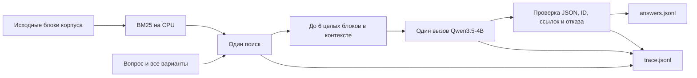

# Первый локальный RAG baseline

23 октября 2026 собран BM25 baseline и выполнен реальный прогон 15
пилотных вопросов через локальную Qwen3.5-4B. После двух общих правок
оформления результат — **9/15 (60%) по точному набору вариантов и отказу**.
Четыре вопроса закончились техническим/форматным отказом, ещё в двух модель
выбрала неверный набор. Это исходная точка для дальнейших улучшений.

## Архитектура и воспроизведение

Код: `build_index.py`, `rag_baseline.py`, `predict.py`,
`evaluate_pilot.py`; настройки — `config.baseline.json`, команды — `README.md`.
Исходный профиль после сравнения сохранён под этим именем без изменения
содержимого; основной `config.json` теперь относится к гибридной системе.
Один исходный блок — один документ. Текст при выдаче сохраняется целиком,
включая пробелы и переводы строк пространственных формул. Поисковая
нормализация отделена от текста, передаваемого модели. Индекс охватывает
весь корпус: 1066 блоков, 147 страниц.

BM25: k1=1.2, b=0.75; заголовок раздела включён в поисковый текст дважды.
Запрос содержит вопрос и все варианты. Рассматриваются 24 кандидата,
контекст включает до 6 блоков. Блок, превышающий остаток бюджета, целиком
пропускается. Полный chat prompt ограничен 5600 токенами; разрешённый выход
1024 токена. Используется токенизатор Qwen той же ревизии, сохранённый в
индексе для работы без сети. В этом прогоне подсчёт входных токенов
клиентом совпал с endpoint на всех 15 вопросах.

Генерация: temperature=0, thinking выключен, один вызов без повторов.
Модель — исходные BF16-веса Qwen3.5-4B, ревизия
`851bf6e806efd8d0a36b00ddf55e13ccb7b8cd0a`; локальный MLX на Apple GPU.
Это предварительный профиль, выбранный до получения официального runtime.

## Результаты и происхождение

| Этап | Точные ответы/отказы | Ошибки формата или выполнения |
| --- | ---: | ---: |
| Первоначальная строгая проверка | 7/15 | 6 |
| Общая нормализация оформления | 9/15 | 4 |

Обе строки используют **одни и те же 15 ответов модели**. Второй этап
повторно обработал сохранённый trace без новых вызовов Qwen. В нём
экранируются недопустимые JSON escape-последовательности; при явном
`abstain=true` и пустом `answer_ids` удаляются оставленные моделью ссылки.
Набор выбранных вариантов, решение об отказе и текст аргументов не
переосмысливаются. Незакрытые кавычки, неполные ответы и противоречивые
структуры остаются ошибками. Та же нормализация включена в `predict.py`.

Исходный прогон: `local_data/baseline_v1/answers.jsonl`, `trace.jsonl`,
`metrics.json`. Итог обработки: `local_data/baseline_canonical/answers.jsonl`,
`trace.jsonl`, `metrics.json`, `metrics_cases.jsonl`. Повторная обработка
воспроизводится `tools/revalidate_saved_run.py`; в trace сохранены исходный
статус, контрольная сумма старого trace и фактический расход endpoint.
Один предварительный запрос для проверки подключения хранится отдельно в
`local_data/baseline_initial/` и не включён в метрики набора.

| Категория | Совпало |
| --- | ---: |
| Условия теорем | 3/5 |
| Сопоставление | 3/4 |
| Применение | 2/3 |
| Недостаточность данных | 1/3 |

Средний расход: 2092.73 входных и 400.8 выходных токена, один вызов на
вопрос. Учебная стоимость `input + 4 × output + 256 × calls` — 3951.93.
Медиана времени исходного прогона — 14.59 секунды. Максимумы — 2804 входных
и 1024 выходных токена. Превышений лимитов не было; расход подтверждён
ответами endpoint. Технический отказ не засчитывается как правильный,
даже если эталонный вопрос предполагает отказ.

Диагностическая доля найденных эталонных страниц — 0.6444. Страницы в
пилотном gold служат подсказкой: они не задают допустимые наборы блоков.
Показатель не является F1 источников и не доказывает достаточность
найденного контекста.

## Разбор ошибок

1. **pilot_q_002, производные по сопряжённой переменной.** Нужная страница
   12 найдена. Модель сначала указала A,C,D, затем в обосновании перешла к
   A,C и вставила неэкранированные кавычки. Ответ отклонён. Сам факт
   нахождения правильной формулы не обеспечил согласованный JSON.
2. **pilot_q_007, факториал в интегральной формуле.** В контекст попали
   страницы 26,28,40,94,118,143; страницы 20 и 34 из эталонной подсказки не
   найдены. Выбран B, хотя обоснование завершилось значением и вариантом C.
   Видны две проблемы: ранжирование формул и согласованность выбора с
   аргументом. Подмена `answer_ids` по последней фразе не выполнялась.
3. **pilot_q_012, предельная точка нулей.** Контекст содержит страницы
   51,65,66,73,82,110; подсказка указывает 21,37,38. Модель выбрала B,C
   вместо A,C. Поиск не доставил нужную формулировку теоремы единственности.

Дополнительно q005 остался с некорректными кавычками, q013 исчерпал выходной
бюджет, q014 превысил длину обоснования и выбирал возможные значения вместо
отказа. Эти ответы не исправлялись по эталонам. Даже при совпадении набора
вариантов качество обоснования требует отдельной проверки: например, в
q001 модель неточно описала роль непрерывности частных производных.

## Ресурсы и границы оценки

Индекс с токенизатором занимает около 22.3 MB. Первый build занял 1.05 с,
пиковая RSS процесса сборки с загрузкой токенизатора — 314 MB. Оборудование:
Mac M4 Pro, 48 GB RAM; retrieval выполняется на CPU, генерация — отдельно
на Apple GPU. Индекс также реально собран из другой рабочей папки с
абсолютными путями. Зависимости клиента закреплены в `requirements.txt`;
MLX и инструменты PDF находятся в отдельном `requirements-local.txt`.

Официальный корпус, gold с наборами block_id, runtime и evaluator не
получены. ID локальные. Поэтому Q, F1 ссылок, E и итоговый балл ДЗ не
вычисляются. 60% — только точность набора вариантов/отказа на небольшом
открытом пилоте, без полной содержательной оценки аргументов и ссылок.
Три конфигурации и две абляции полного задания ещё не выполнены.

Индекс и ответы построены программно. При сборке индекса нет LLM-вызовов;
при предсказании сеть используется для заданного endpoint. Код написан с
помощью Codex, автотесты не создавались и не запускались. Для следующих
экспериментов полезны улучшение доставки формул и проверка структурированного
ответа при сохранении исходного baseline для сравнения.
