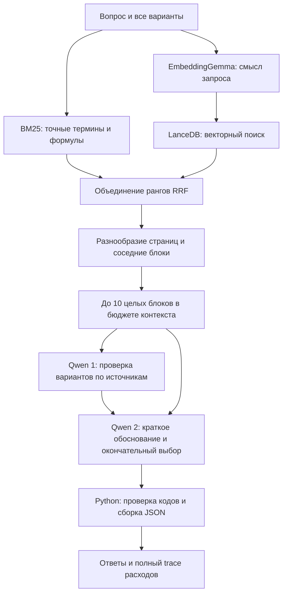

# RAG средней сложности для локального Mac

Система объединяет лексический и смысловой поиск, доставляет соседние
фрагменты, затем отдельно проверяет варианты и формирует окончательный
выбор. EmbeddingGemma и поиск работают на CPU по условию ДЗ; Qwen3.5-4B
выполняется на Apple GPU через локальный MLX endpoint.

## Что добавляет каждый компонент

**BM25** сохраняет поиск по точным формулировкам и математическим символам.
**EmbeddingGemma** даёт дополнительный канал для близких по смыслу
формулировок. Используется
[EmbeddingGemma-300M](https://ai.google.dev/gemma/docs/embeddinggemma/model_card)
в публичной [ONNX-сборке q8](https://huggingface.co/onnx-community/embeddinggemma-300m-ONNX/tree/5090578d9565bb06545b4552f76e6bc2c93e4a66).
Ревизия зафиксирована; используется полный выход `sentence_embedding`
с обученной проекцией, 768 измерений и нормализацией длины. Для запросов
и документов применяются разные рекомендованные префиксы. Контент не
обогащается генеративно.

**LanceDB** хранит векторы, исходный текст, страницу, раздел и block_id
в локальной папке. На небольшом корпусе используется точный поиск по
скалярному произведению нормализованных векторов. Отдельный сервер,
контейнер и приближённый ANN-индекс здесь не нужны.
[Документация векторного поиска](https://docs.lancedb.com/search/vector-search).

По 60 кандидатов из BM25 и векторного поиска объединяются через RRF:

$$
\operatorname{RRF}(b)=
\frac{1}{60+r_{\mathrm{BM25}}(b)}+
\frac{1}{60+r_{\mathrm{dense}}(b)}.
$$

Отсутствующий в одном канале блок получает вклад только второго канала.
Так не требуется сравнивать несовместимые абсолютные BM25/cosine scores.
Выбираются пять основных блоков с ограничением не более двух основных
блоков на страницу. Добавляются непосредственно соседние блоки той же
страницы и раздела, чтобы доставить формулу вместе с условием или
доказательством. Если остаётся место, используются следующие кандидаты.
Контекст ограничен десятью блоками и токенным бюджетом.

## Работа с формулами и источниками

Один цитируемый документ — один исходный блок. Для эмбеддингов длинный
блок делится на окна по 700 токенов с перекрытием 80 токенов. Исходные
тексты и ID остаются неизменными; поиск по нескольким окнам сводится
к одному исходному block_id. Для этой книги получено 1076 окон на 1066
блоков. Пробелы сжимаются только в представлении для эмбеддингов.

В контекст поступают целые исходные блоки, включая пространственные
формулы. Непоместившийся блок пропускается целиком. Страницы и исходная
разметка сохраняются. Неоднозначные символы с меткой ※ не исправляются
по догадке. Официальные block_id ещё не получены, поэтому текущие ID
локальные, как описано в `extraction_notes.md`.

## Ответ и защита формата

Первый вызов Qwen даёт короткую таблицу проверки каждого варианта:
вердикт, аргумент, источник. Второй получает те же исходные фрагменты
и эту заметку, сверяет её и выдаёт три текстовых поля: `REASON`,
`SOURCES`, `CHOICES`. Коды O1… соответствуют текущему порядку вариантов,
а S1… — текущим источникам; отображение на реальные ID фиксирует клиент.

Python проверяет допустимость кодов и ссылок и сам сериализует JSON.
Кавычки и LaTeX в обосновании не могут сломать сериализацию. При явном
отказе списки вариантов и источников пусты. При неразбираемом выборе
возвращается технический отказ, который оценщик засчитывает как ошибку.
Обоснование ограничено 1200 символами; полный исходный ответ сохраняется
в trace. Выбранные варианты не исправляются по эталонам или последней
фразе обоснования.

Это фиксированная цепочка из двух вызовов, а не адаптивный агент.
У неё нет поиска в интернете, памяти между вопросами, генеративного
переписывания корпуса и вызовов Qwen при индексации.

## Лимиты, воспроизводимость и Mac

Оба вызова используют одни и те же параметры генерации, что и baseline:
temperature=0, thinking выключен, до 1024 выходных токенов на вызов.
Первый prompt ограничен 5600 токенами. Перед каждым вызовом проверяются
его размер с разрешённым выходом и остатки общих бюджетов вопроса.
Фактические usage обоих вызовов суммируются в trace вместе с
идентификаторами вопроса и прогона, стадиями, источниками и суммами файлов.
Ключ API
в trace не записывается. Повторных запросов по ошибке нет.

Для Mac M4 Pro с 48 GB RAM реальная сборка заняла 70.6 секунды,
пиковая RSS процесса — 2.26 GB. Индекс с файлами энкодера занимает
357 MB. Энкодер работает через `CPUExecutionProvider`, шесть потоков;
Qwen использует GPU через MLX. Это измерения сборки индекса, не полной
памяти процесса Qwen.

Код разделён на `hybrid_retrieval.py` и `hybrid_pipeline.py`; обычные CLI
`build_index.py` и `predict.py` выбирают систему по конфигурации.
Настройки находятся в `config.json`, зависимости закреплены в
`requirements.txt`. База, корпус и веса исключены из Git. Индекс
пересобирается из корпуса и закреплённых публичных моделей.

Официальный runtime пока отсутствует, профиль остаётся пилотным.
Сравнение с первым baseline и результаты 15 вопросов находятся в
`hybrid_report.md`; сравнение без контекста и две абляции — в
`comparison_report.md`. Официальный Q и F1 источников без комплекта задания
не вычисляются. Baseline сохранён в `config.baseline.json`.

Итоговый отчёт — `report.md`, проверка доказательств и полноты
цитирования — `citation_audit.md`. Аудит фиксирует ограничения выбранной
системы и не изменяет сохранённые предсказания.
